<!-- BADGES DE CONTATO -->

  
  
  

<h1 align="center">🌟 Olá! Eu sou a Evellyn Silva</h1>

<!-- TYPING EFFECT -->

  

 

<!-- SOBRE MIM -->
<table>
  <tr>
    <td width="390px" valign="middle">
      
    </td>
    <td valign="middle">
      <h3>👩‍💻 Sobre Mim</h3>
      

        🎓 Graduanda em <strong>Análise e Desenvolvimento de Sistemas (ADS)</strong>.  
        💻 <strong>Desenvolvedora Full-Stack</strong> focada em criar interfaces modernas, responsivas e sistemas escaláveis de ponta a ponta.  
        ⚡ Experiência prática no desenvolvimento de <strong>portais corporativos de alta performance, PWAs, plataformas de gestão educacional, sistemas financeiros e de agendamento</strong>.  
        ☁️ Atuação com <strong>React, Next.js, TypeScript, Supabase, Python</strong>, automações inteligentes com <strong>IA</strong> e deploy em nuvem com <strong>Google Cloud (GCP), CI/CD (GitHub Actions) e Vercel</strong>.
      

    </td>
  </tr>
</table>

---

<!-- SKILLS -->
<h3 align="left">🛠 Tecnologias & Ferramentas</h3>

<strong>Front-End, Mobile & UI/UX</strong>

  

<strong>Back-End, Banco de Dados, Cloud & DevOps</strong>

  

---

<!-- PROJETOS EM DESTAQUE -->
<h3 align="left">🚀 Projetos Públicos em Destaque</h3>

<table>
  <tr>
    <td width="50%" valign="top">
      <h4>🌐 <a href="https://github.com/EveeSilvaa/meu-portifolio">Meu Portfólio</a></h4>
      
Portfólio interativo apresentando projetos, trajetória e habilidades com animações fluidas e design responsivo.

      
<code>React 19</code> <code>TypeScript</code> <code>Tailwind v4</code> <code>Framer Motion</code> • <a href="https://meu-portifolio-eveesilvaa.vercel.app/">Ver Demo</a>

    </td>
    <td width="50%" valign="top">
      <h4>💰 <a href="https://github.com/EveeSilvaa/controles-contas">Controle de Contas (PWA)</a></h4>
      
Aplicação Full-Stack / PWA para gestão financeira com dashboards e gráficos interativos em tempo real.

      
<code>React</code> <code>TypeScript</code> <code>Supabase</code> <code>Recharts</code> <code>PWA</code>

    </td>
  </tr>
  <tr>
    <td width="50%" valign="top">
      <h4>🌸 <a href="https://github.com/EveeSilvaa/hanami.in">Hanami.in</a></h4>
      
Plataforma web moderna com integração em nuvem, autenticação, animações e geração dinâmica de QR Code.

      
<code>React 19</code> <code>TypeScript</code> <code>Supabase</code> <code>Tailwind CSS</code>

    </td>
    <td width="50%" valign="top">
      <h4>✈️ <a href="https://github.com/EveeSilvaa/travel-guide">Travel Guide</a></h4>
      
Aplicação web de guia de viagens consumindo APIs REST com renderização moderna em Next.js.

      
<code>Next.js 15</code> <code>React 19</code> <code>Axios</code> <code>JavaScript</code>

    </td>
  </tr>
</table>

---

<!-- GITHUB STATS -->
<h3 align="left">📊 Estatísticas & Contribuições</h3>

  

 

<picture data-importer="pacman">
  <source media="(prefers-color-scheme: dark)" srcset="https://raw.githubusercontent.com/EveeSilvaa/EveeSilvaa/pacman-output/galaga-contribution-graph-dark.svg?game=galaga">
  <source media="(prefers-color-scheme: light)" srcset="https://raw.githubusercontent.com/EveeSilvaa/EveeSilvaa/pacman-output/galaga-contribution-graph.svg?game=galaga">
  
</picture>
